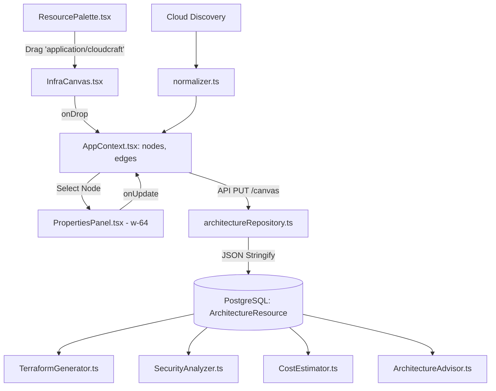
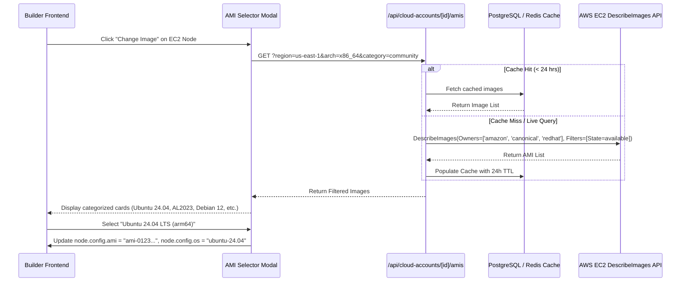
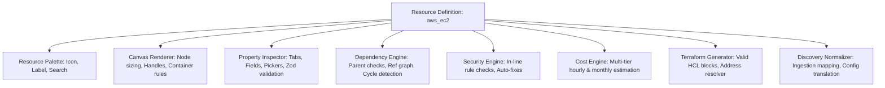
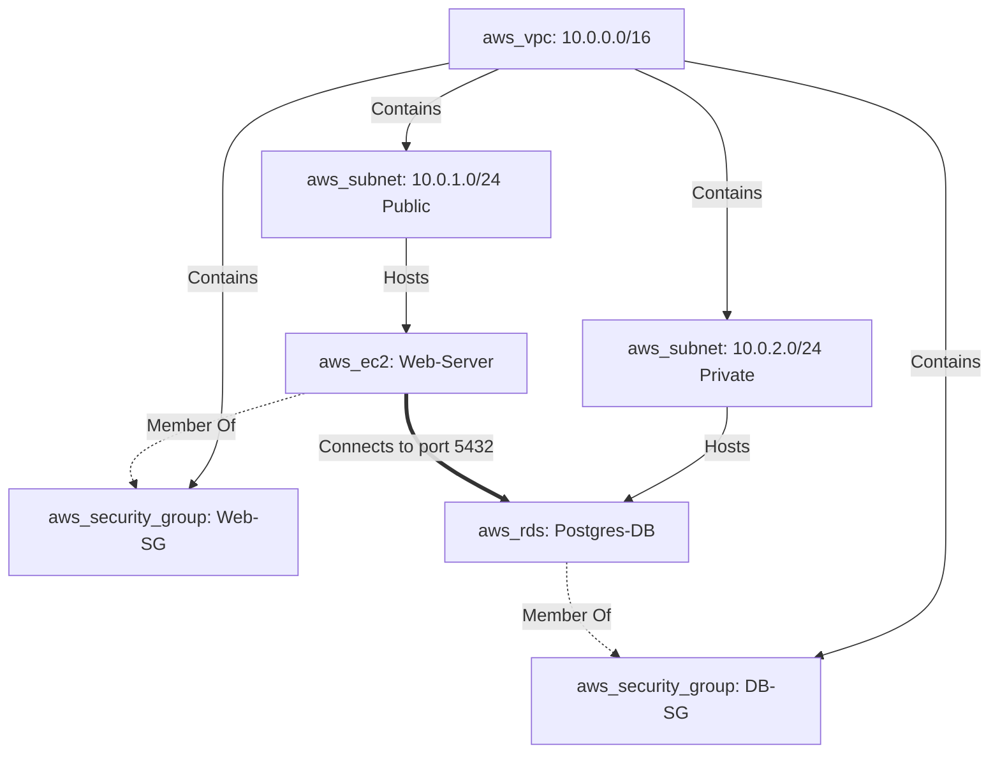
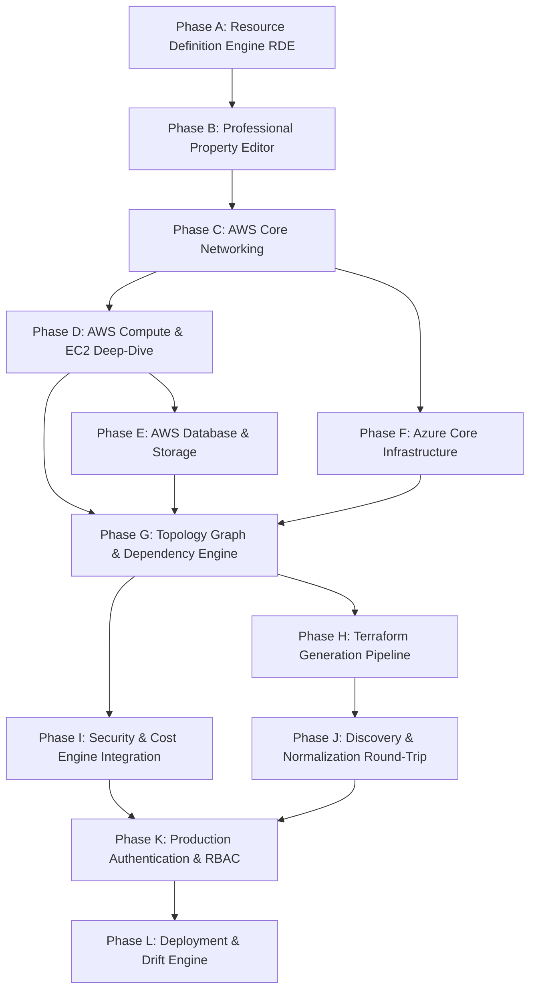

# CloudBuilder Commercial Builder Architecture & Technical Specification

> **Document Status**: Complete Architecture Audit & Strategic Implementation Plan  
> **Target Version**: CloudBuilder Commercial MVP  
> **Scope**: Resource Definition Engine, Deep Configuration, Multi-Cloud Catalog, Validation Graph, Terraform Generation, Security, Cost, and Enterprise UX

---

## Executive Summary

CloudBuilder currently possesses a functional proof-of-concept canvas with basic node drag-and-drop, rudimentary configuration fields, static Terraform generation, and mock-free integration with PostgreSQL. However, **the current resource model cannot support a commercial-grade cloud infrastructure builder.**

Key findings from this audit:
1. **Toy Resource Configuration**: Resources like AWS EC2 and Azure VM provide only 3–4 primitive fields (name, instance type, static AMI string, key pair). Crucial production attributes (EBS storage volumes, IAM instance profiles, user data/cloud-init, network interfaces, VPC/subnet bindings, detailed monitoring, IMDSv2) are completely absent.
2. **Brittle Connection-Based Dependencies**: Relationships rely exclusively on users manually drawing directional React Flow wires. A connection drawn backwards (from target to source) silently breaks parent resolution in the Terraform generator. There are no container semantics (e.g., dropping an EC2 inside a Subnet inside a VPC).
3. **Hardcoded Switch-Based Engines**: The Terraform generator, Security analyzer, Cost estimator, and Discovery normalizer all maintain independent, hardcoded `switch(resourceType)` statements. Adding a single cloud resource requires manually modifying 6+ disconnected files across the repository.
4. **Primitive Properties UI**: The current `PropertiesPanel.tsx` is fixed at 256px width and only renders 4 basic HTML inputs (`text`, `number`, `boolean`, `select`). It cannot render nested objects, repeatable lists, key-value maps, resource pickers, CIDR calculators, code editors, or AMI selectors.
5. **Architectural Remedy**: Introduce a unified **Resource Definition Engine (RDE)** where **one single, declarative specification** drives the catalog, canvas visual, property inspector, dependency validation, security analysis, cost estimation, Terraform mapping, and cloud discovery.

---

## 1. Current Builder Architecture Assessment

### 1.1 Codebase Structure & Component Flow



### 1.2 Inspection of Key Architectural Subsystems

| Subsystem | Source File(s) | Current Implementation | Critical Limitations |
| :--- | :--- | :--- | :--- |
| **Resource Registry** | `lib/resources/aws.ts`<br>`lib/resources/azure.ts`<br>`lib/resources/index.ts` | Static arrays of `ResourceDefinition` objects. Only 9 AWS and 9 Azure resources defined. | Extremely shallow schemas; `configSchema` only supports 5 scalar types. No dependency or container metadata. |
| **Property Types** | `types/index.ts:89-98` (`ConfigField`) | `type: 'text' \| 'number' \| 'select' \| 'boolean' \| 'cidr'` | No support for objects, arrays, key-value maps, code blocks, resource references, or dynamic cloud data. |
| **Properties UI** | `components/canvas/PropertiesPanel.tsx` | Fixed width 256px (`w-64`), single flat column, loops over `configSchema`. | No tabs, no validation error display, no search, no collapsible sections, no complex widgets. |
| **Canvas Node** | `components/canvas/CloudNode.tsx` | Simple rounded rectangle (110px min-width) with icon, label, and 4 static handles. | No container/grouping capabilities, no status badges, no error indicators, no volume attachments. |
| **Canvas Interaction** | `components/canvas/InfraCanvas.tsx` | React Flow instance with standard drag/drop and edge connection handlers. | Direction-sensitive edge creation; dropping resources does not detect parent containers; no auto-connecting. |
| **Terraform Engine** | `lib/engines/terraform/TerraformGenerator.ts` (909 lines) | 900+ lines of imperative string concatenation inside a massive `switch(resourceType)`. | Reverse edge bug (`targetId === targetId`); hardcoded fallback strings (`ami-0c55b159cbfafe1f0`); Azure VM emits invalid `network_interface_ids = []`. |
| **Security Engine** | `lib/engines/security/awsRules.ts`<br>`lib/engines/security/azureRules.ts` | 9 AWS rules, 7 Azure rules in static arrays. Checks single resource `configJson`. | Very limited multi-resource context; rules evaluate against simplistic booleans rather than real infrastructure topologies. |
| **Cost Engine** | `lib/engines/cost/awsPricing.ts`<br>`lib/engines/cost/azurePricing.ts` | Hardcoded static pricing tables for a handful of instance types and regions. | No real-time API query; ignores storage IOPS, throughput, data transfer, and multi-disk setups. |
| **Database Model** | `src/prisma/contract.prisma` | `ArchitectureResource` stores `configJson` as a plain string, `groupId` as nullable string. | No schema versioning; no native parent-child relational hierarchy; no typed indexing on configurations. |
| **Discovery Normalizer** | `lib/cloud/normalizer.ts` | `RESOURCE_TYPE_MAP` maps discovered strings to CloudBuilder types, laying out in a fixed 4-column grid. | Drops unmapped configurations into `_metadata`; lacks reverse fidelity with user-created canvas nodes. |

---

## 2. AWS Service Coverage Matrix

Evaluation of all AWS resources currently present in `lib/resources/aws.ts`:

| Resource Type | CloudBuilder Identifier | Canvas Support | Config Support | Validation Support | Security Support | Cost Support | Terraform Support | Discovery Support | Maturity Tier |
| :--- | :--- | :---: | :---: | :---: | :---: | :---: | :---: | :---: | :---: |
| **VPC** | `aws_vpc` | B | B | B | B (1 rule) | A (Free) | B | B | **B** |
| **Subnet** | `aws_subnet` | B | B | B | B (1 rule) | A (Free) | B | B | **B** |
| **EC2 Instance** | `aws_ec2` | B | C | D | B (2 rules) | B (Basic) | B | B | **B-** |
| **S3 Bucket** | `aws_s3` | B | B | D | A (3 rules) | C (Flat) | A | B | **B** |
| **RDS Instance** | `aws_rds` | B | B | D | A (3 rules) | B (Basic) | B | B | **B** |
| **Application LB** | `aws_alb` | B | C | D | D (None) | B (Flat) | B | B | **C+** |
| **Internet Gateway** | `aws_igw` | B | C (Name only) | D | D (None) | A (Free) | B | B | **B-** |
| **NAT Gateway** | `aws_nat` | B | C (2 fields) | D | D (None) | B (Flat) | B | B | **B-** |
| **Security Group** | `aws_sg` | B | C (3 bools) | D | B (1 rule) | A (Free) | B | B | **B-** |

### Legend:
- **A (Genuinely Usable)**: Production-grade schema, validation, security, and Terraform output.
- **B (Partially Usable)**: Functional for basic proof-of-concept architectures; missing deep options.
- **C (Placeholder / Mock)**: Barebones stub with 1–3 toy fields; inadequate for real infrastructure.
- **D (Unsupported / Broken)**: Missing completely or produces invalid configurations/code.

### Critical AWS Deficiencies:
- **Only 9 services exist** out of ~200 AWS services.
- **Networking**: Missing Route Tables, Routes, Network ACLs, Elastic IPs (as standalone entities), VPC Endpoints, Transit Gateways, Peering Connections.
- **Compute**: Missing Auto Scaling Groups, Launch Templates, ECS, EKS, Lambda, App Runner.
- **Database**: Missing Aurora Clusters, DynamoDB, ElastiCache (Redis/Memcached).
- **Storage**: Missing standalone EBS Volumes, EFS, FSx.
- **Security & IAM**: Missing IAM Roles, Policies, Instance Profiles, KMS Keys, Secrets Manager, WAF.
- **Observability**: Missing CloudWatch Alarms, Log Groups, CloudTrail.

---

## 3. Azure Service Coverage Matrix

Evaluation of all Azure resources currently present in `lib/resources/azure.ts`:

| Resource Type | CloudBuilder Identifier | Canvas Support | Config Support | Validation Support | Security Support | Cost Support | Terraform Support | Discovery Support | Maturity Tier |
| :--- | :--- | :---: | :---: | :---: | :---: | :---: | :---: | :---: | :---: |
| **Resource Group** | `azure_resource_group` | B | B (Name, Location) | D | D (None) | A (Free) | B | B | **B** |
| **Virtual Network** | `azure_vnet` | B | B (CIDR) | D | B (1 rule) | A (Free) | B | B | **B** |
| **Subnet** | `azure_subnet` | B | B (CIDR) | D | D (None) | A (Free) | B | B | **B** |
| **Virtual Machine** | `azure_vm` | B | C (3 fields) | D | B (1 rule) | B (Basic) | **D (Broken NICs)** | B | **C** |
| **Storage Account** | `azure_storage` | B | B | D | A (2 rules) | B (Basic) | B | B | **B** |
| **Azure SQL** | `azure_sql` | B | B | D | A (2 rules) | B (Basic) | B | B | **B** |
| **Load Balancer** | `azure_lb` | B | C (SKU only) | D | D (None) | B (Basic) | B | B | **C** |
| **NAT Gateway** | `azure_nat` | B | C (Timeout only) | D | D (None) | B (Basic) | B | B | **C** |
| **NSG** | `azure_nsg` | B | C (2 bools) | D | A (2 rules) | A (Free) | B | B | **B-** |

### Provider-Specific Differences Between AWS and Azure:
1. **Resource Group Scoping**: Every Azure resource *must* be scoped inside an `azurerm_resource_group`. AWS resources exist within a Region and Account without a resource-group parent container.
2. **Network Interface Mandate**: Unlike AWS EC2 (where `subnet_id` can be specified directly on `aws_instance`), Azure VMs **cannot attach directly to a subnet**. An `azurerm_network_interface` (NIC) *must* be created and connected to the subnet, and the VM references the NIC ID. CloudBuilder's current Terraform generator produces `network_interface_ids = []`, which causes `terraform apply` to fail immediately.
3. **OS Disks & Managed Disks**: Azure VMs mandate explicit `os_disk` blocks with caching and storage account types (`Standard_LRS`, `Premium_LRS`), whereas AWS defaults root EBS volumes if omitted.
4. **VNet vs VPC Structure**: Azure VNets define multiple disjoint `address_prefixes`, whereas AWS VPCs specify a primary CIDR block and optional secondary CIDRs.

---

## 4. EC2 Deep-Dive: Commercial vs Current Implementation

The table below benchmarks CloudBuilder's current EC2 resource against commercial infrastructure platform requirements:

| Category | Property / Requirement | Commercial Standard | Current CloudBuilder Implementation | Status |
| :--- | :--- | :--- | :--- | :--- |
| **Identity** | Name Tag | Configurable string with standard regex validation | Text input (`name: 'my-ec2'`) | **Partially supported** |
| | Tags Map | Arbitrary Key/Value pairs (`Environment`, `CostCenter`, `Owner`) | Completely absent | **Missing** |
| **Image** | AMI Selection | Visual selector with OS filters, architecture, publisher, region | Hardcoded text string `ami-0c55b159cbfafe1f0` | **Toy / Hardcoded** |
| | OS / Image Type | Ubuntu, Amazon Linux 2023, RHEL, Debian, Windows | Not modeled | **Missing** |
| | CPU Architecture | `x86_64` vs `arm64` (Graviton compatibility) | Not modeled | **Missing** |
| | Region Validation | Ensure AMI exists in target region | Not validated; AMI string accepted blindly | **Missing** |
| **Compute** | Instance Type | 500+ AWS types (T3, T4g, M6i, M7g, C7g, R7g, P4d) | 8 hardcoded types in a dropdown | **Severely limited** |
| | Tenancy | `default`, `dedicated`, `host` | Hardcoded default | **Missing** |
| | Graviton Matching | Enforce arm64 AMI if `t4g`/`m7g` selected | No validation | **Missing** |
| **Networking** | VPC Binding | Direct reference or container containment | Only derived if wire is manually drawn | **Brittle** |
| | Subnet Selection | Subnet dropdown filtered by VPC and AZ | Only derived if wire is manually drawn | **Brittle** |
| | Security Groups | Multi-select picker of existing Security Groups | Only derived from single incoming wire | **Severely limited** |
| | Public IP | `associate_public_ip_address = true \| false \| subnet_default` | Not modeled | **Missing** |
| | Private IP | Optional static private IP allocation | Not modeled | **Missing** |
| | Availability Zone | Explicit AZ placement or subnet-inherited | Missing on EC2 | **Missing** |
| | Secondary ENIs | Additional network interfaces | Not modeled | **Missing** |
| **IAM** | Instance Profile | IAM Role / Instance Profile dropdown | Not modeled | **Missing** |
| **Storage** | Root Volume Size | Configurable GB (e.g. 20GB, 50GB, 100GB) | Assumed 20GB in cost calculation only; not in schema | **Missing from UI/Schema** |
| | Root Volume Type | `gp3`, `gp2`, `io2`, `st1` | Not modeled; hardcoded `gp3` in pricing | **Missing from Schema** |
| | Root IOPS / Throughput | Configurable for `gp3` / `io2` | Not modeled | **Missing** |
| | Root Encryption | KMS Key ID / AWS Managed Key | Not modeled | **Missing** |
| | Additional EBS Disks | Repeatable array of secondary EBS volumes | Not modeled | **Missing** |
| **Availability** | Placement Groups | Cluster, Spread, Partition | Not modeled | **Missing** |
| | Detailed Monitoring | CloudWatch detailed monitoring boolean | Not modeled | **Missing** |
| **Advanced** | User Data | Shell script / cloud-init script with variable interpolation | Not modeled | **Missing** |
| | IMDSv2 Metadata | `http_tokens = "required"` (AWS security standard) | Not modeled | **Missing** |
| | Termination Protection | `disable_api_termination = true \| false` | Not modeled | **Missing** |
| | Stop / Terminate Behavior | `instance_initiated_shutdown_behavior` | Not modeled | **Missing** |

---

## 5. AMI Selection Architecture

A commercial cloud builder cannot require users to memorize or look up 21-character AWS AMI IDs in the AWS Console. CloudBuilder must provide an intelligent, region-aware, architecture-aware image selection engine.

### 5.1 Architecture Diagram



### 5.2 Key Architecture Capabilities

1. **Static Curated Catalog (Offline & Fast)**:
   - For users without a connected AWS account, maintain a curated, version-controlled JSON catalog of the latest standard base AMIs for the top 10 AWS regions:
     - Ubuntu 24.04 LTS & 22.04 LTS (Canonical)
     - Amazon Linux 2023 & Amazon Linux 2 (Amazon)
     - Debian 12 "Bookworm"
     - Red Hat Enterprise Linux 9
     - Windows Server 2022 Base
   - Both `x86_64` and `arm64` variants mapped per region.
2. **Dynamic Account-Aware Discovery (Connected Accounts)**:
   - When a user has connected an AWS account via `CloudAccount`, the backend queries `ec2:DescribeImages` with:
     - `ExecutableUsers: ['self']` (Private custom AMIs built with Packer)
     - `Owners: ['amazon', '099720109477' (Canonical), '309956199498' (RHEL)]`
   - Filtered dynamically by the canvas project's active AWS region.
3. **Architecture-Aware Filtering**:
   - If the user selects an instance type belonging to the Graviton family (e.g. `t4g.*`, `c7g.*`, `m7g.*`), the AMI selector **strictly filters to `arm64` images**.
   - If an `x86_64` instance type is selected (e.g. `t3.*`, `m5.*`), the selector **strictly filters to `x86_64` images**.
   - Mismatches trigger an instant validation error before Terraform generation.
4. **Caching & Invalidation Strategy**:
   - Dynamic AWS AMI lookups are expensive (several MBs of JSON).
   - Cache results in a PostgreSQL table `AmiCatalogCache` or Redis with a 24-hour TTL keyed by `(accountId, region, architecture, owner)`.

---

## 6. Resource Definition Engine (RDE) Design

The **Resource Definition Engine** is the core foundational architecture for CloudBuilder. Instead of writing ad-hoc code across 6 different subsystems, **a single declarative definition specifies everything about a cloud resource.**

### 6.1 Unified Resource Definition Interface (`lib/rde/types.ts`)

```typescript
export interface ResourceDefinition<TConfig = Record<string, unknown>> {
  // ── 1. Metadata ──
  id: string;                         // e.g. 'aws_ec2'
  provider: 'aws' | 'azure' | 'gcp';
  service: string;                     // e.g. 'EC2', 'VPC', 'RDS'
  displayName: string;                // e.g. 'EC2 Instance'
  category: ResourceCategory;
  icon: string;                        // SVG path or icon identifier
  color: string;
  description: string;
  documentationUrl: string;

  // ── 2. Canvas & Visual Hierarchy ──
  visual: {
    isContainer: boolean;              // true for VPC, Subnet, Resource Group
    allowedChildren?: string[];        // e.g. aws_vpc allows ['aws_subnet']
    defaultDimensions?: { width: number; height: number };
    minDimensions?: { width: number; height: number };
    portRules: PortRule[];             // Connection port definitions
  };

  // ── 3. Properties & Schema ──
  defaultConfig: TConfig;
  propertyGroups: PropertyGroup[];     // Multi-tab property schema
  validationSchema: z.ZodSchema<TConfig>;

  // ── 4. Dependencies & Topology ──
  dependencies: {
    requiresParent?: {
      types: string[];                 // e.g. ['aws_subnet']
      errorMessage: string;
    };
    references: ReferenceRule[];       // e.g. Security Groups, IAM Roles
  };

  // ── 5. Terraform Mapping ──
  terraform: {
    primaryResourceType: string;       // e.g. 'aws_instance'
    auxiliaryResources?: (config: TConfig, ctx: TransformContext) => TerraformResourceBlock[];
    generateHcl: (config: TConfig, ctx: TransformContext) => string;
  };

  // ── 6. Security Analysis ──
  securityRules: DeclarativeSecurityRule<TConfig>[];

  // ── 7. Cost Calculation ──
  costCalculator: (config: TConfig, region: string) => CostBreakdown;

  // ── 8. Discovery Normalization ──
  discoveryMapping: {
    providerResourceTypes: string[];   // e.g. ['ec2-instance', 'AWS::EC2::Instance']
    toCanvasConfig: (raw: DiscoveredResource) => TConfig;
  };
}
```

### 6.2 Data Flow Driven by Single Definition



---

## 7. Property Editor Architecture

To handle enterprise cloud configurations, the properties panel must be overhauled from a simple 256px column into a **professional multi-tab inspector**.

### 7.1 Panel Layout & Dimensions

- **Width**: Responsive/resizable 380px to 480px docked to the right edge of the canvas.
- **Header**: Resource Icon, editable Name tag, Resource Type badge, Estimated Cost pill, Close button.
- **Tab Navigation**:
  - `General`: Name, Tags, Region, Description.
  - `Compute / Specs`: Instance Type, CPU Arch, Tenancy, Credit Specification.
  - `Networking`: Subnet selector, IP assignments, Security Groups multi-picker.
  - `Storage`: Root block device (size, type, IOPS, encryption), additional EBS volumes.
  - `Security & IAM`: IAM Instance Profile, IMDSv2 token enforcement, Key Pair.
  - `Advanced`: User Data (Monaco/CodeMirror script editor), Termination Protection.
- **Footer**: Live validation diagnostics (errors/warnings) and quick-fix buttons.

### 7.2 Comprehensive Field Type Catalog

| Field Type Identifier | Component Widget | Purpose / Example |
| :--- | :--- | :--- |
| `text` | `<TextInput>` | Simple identifiers, string tags. |
| `number` | `<NumberInput>` | Port numbers, timeouts, capacity counts. |
| `boolean` | `<ToggleSwitch>` | Flags (e.g. `enableDnsSupport`, `publiclyAccessible`). |
| `enum` | `<SegmentedControl>` or `<Select>` | Fixed options (e.g. `public` vs `private`). |
| `searchable-select` | `<Combobox>` | Long lists (e.g. 500+ AWS instance types). |
| `multi-select` | `<TagCombobox>` | Multiple associations (e.g. multiple Security Groups). |
| `resource-ref` | `<CanvasResourcePicker>` | Dropdown populated with compatible nodes from active canvas. |
| `cloud-resource-ref` | `<LiveCloudResourcePicker>` | Fetches existing cloud IDs (e.g. existing IAM roles from AWS). |
| `region-select` | `<RegionPicker>` | Provider-aware region selector. |
| `az-select` | `<AzPicker>` | Dynamic AZ selector populated based on active region. |
| `ami-select` | `<AmiSelectorModal>` | Visual modal with filters for OS, arch, source, and search. |
| `cidr-input` | `<CidrCalculatorInput>` | CIDR editor with live netmask size and subnet range preview. |
| `secret-ref` | `<SecretSelector>` | Reference to environment variable or KMS/Secrets Manager. |
| `nested-object` | `<ObjectCard>` | Nested field groups (e.g. `root_block_device`). |
| `repeatable-list` | `<RepeatableTable>` | Dynamic lists (e.g. additional EBS volumes, ingress rules). |
| `key-value-map` | `<KeyValueEditor>` | AWS Resource Tags (`Key` / `Value` rows). |
| `code-editor` | `<MonacoEditorWrapper>` | Bash / cloud-init script editor with syntax highlighting. |

---

## 8. Dependency & Validation Engine Design

In the current implementation, dependencies are purely visual lines drawn by the user. If an edge is drawn in reverse or omitted, Terraform output fails or emits broken references.

### 8.1 Unified Topology Graph

CloudBuilder must maintain an in-memory **Directed Acyclic Graph (DAG)** representing infrastructure relationships:



### 8.2 Dependency Rule Types

1. **Containment (Parent-Child)**:
   - Evaluated by spatial placement or explicit selector:
     - `aws_subnet` *must* be contained within `aws_vpc`.
     - `aws_ec2` *must* reside within `aws_subnet`.
     - `azure_subnet` *must* reside within `azure_vnet`.
     - `azure_vm` *must* be scoped to `azure_resource_group`.
2. **Association (References)**:
   - Evaluated by field references:
     - `aws_ec2.securityGroupIds` references one or more `aws_sg` nodes inside the same VPC.
     - `aws_route_table.routes` references `aws_igw` or `aws_nat`.
     - `aws_rds.dbSubnetGroupName` references at least 2 `aws_subnet` nodes in different AZs.
3. **Network Flow (Edges)**:
   - Evaluated by directional traffic edges:
     - Traffic flow from `aws_alb` to `aws_ec2` generates target group attachments and security group ingress rules automatically.

### 8.3 Real-Time Validation Feedback

The engine continuously computes diagnostics and presents them in a bottom drawer:
- **Error (Blocks Terraform Generation)**: Missing parent VPC; Subnet CIDR outside VPC range; EC2 has arm64 instance type with x86_64 AMI; RDS lacks DB subnet group in multi-AZ.
- **Warning (Best Practice)**: EC2 in public subnet without Elastic IP; Security group allows open port 22; S3 bucket lacks encryption.
- **Auto-Fixes**: One-click actions to resolve errors (e.g. "Move subnet into VPC", "Change instance type to t4g.micro", "Enable S3 encryption").

---

## 9. Commercial MVP Service Catalog

A commercial builder must not try to support all 200+ AWS services immediately. We define a prioritized 3-tier roadmap focused on building real production architectures (e.g. Web Apps, Microservices, Data Pipelines).

### 9.1 AWS Service Prioritization

| Category | Service / Resource | MVP | Phase 2 | Phase 3 | Rationale for MVP |
| :--- | :--- | :---: | :---: | :---: | :--- |
| **Networking** | VPC (`aws_vpc`) | **Yes** | | | Foundation for all network isolation. |
| | Subnet (`aws_subnet`) | **Yes** | | | Public/Private routing foundation. |
| | Internet Gateway (`aws_igw`) | **Yes** | | | Required for public internet egress/ingress. |
| | NAT Gateway (`aws_nat`) | **Yes** | | | Required for secure private subnet outbound traffic. |
| | Route Table & Route (`aws_route_table`) | **Yes** | | | Essential for binding subnets to IGW/NAT. |
| | Security Group (`aws_security_group`) | **Yes** | | | Primary stateful firewall mechanism. |
| | Elastic IP (`aws_eip`) | **Yes** | | | Standalone static IP allocation. |
| | Application Load Balancer (`aws_lb`) | **Yes** | | | Traffic distribution and SSL termination. |
| | VPC Endpoint (`aws_vpc_endpoint`) | | **Yes** | | Private AWS API connectivity. |
| | Network ACL (`aws_network_acl`) | | **Yes** | | Stateless subnet filtering. |
| | Transit Gateway (`aws_ec2_transit_gateway`) | | | **Yes** | Enterprise multi-VPC routing. |
| **Compute** | EC2 Instance (`aws_instance`) | **Yes** | | | Core virtual machine workload with deep config. |
| | Launch Template (`aws_launch_template`) | **Yes** | | | Template for auto-scaling and immutable compute. |
| | Auto Scaling Group (`aws_autoscaling_group`) | **Yes** | | | Production elasticity and resilience. |
| | ECS Cluster & Service (`aws_ecs_*`) | | **Yes** | | Containerized workloads (Fargate). |
| | Lambda Function (`aws_lambda_function`) | | **Yes** | | Serverless compute execution. |
| | EKS Cluster (`aws_eks_*`) | | | **Yes** | Kubernetes infrastructure. |
| **Database** | RDS Instance (`aws_db_instance`) | **Yes** | | | Managed relational database (Postgres/MySQL). |
| | DB Subnet Group (`aws_db_subnet_group`) | **Yes** | | | Required for placing RDS across AZs. |
| | Aurora Cluster (`aws_rds_cluster`) | | **Yes** | | Enterprise high-performance relational DB. |
| | DynamoDB Table (`aws_dynamodb_table`) | | **Yes** | | NoSQL key-value database. |
| | ElastiCache Redis (`aws_elasticache_*`) | | **Yes** | | In-memory caching and session store. |
| **Storage** | S3 Bucket (`aws_s3_bucket`) | **Yes** | | | Object storage with encryption & versioning. |
| | EBS Volume (`aws_ebs_volume`) | **Yes** | | | Standalone and attachable block storage. |
| | EFS File System (`aws_efs_file_system`) | | **Yes** | | Shared network file storage. |
| **Security & IAM** | IAM Role & Policy (`aws_iam_role`) | **Yes** | | | Instance profiles and least-privilege security. |
| | KMS Key (`aws_kms_key`) | **Yes** | | | Customer-managed encryption keys. |
| | Secrets Manager (`aws_secretsmanager_secret`) | | **Yes** | | Dynamic database credential storage. |
| | WAF Web ACL (`aws_wafv2_web_acl`) | | | **Yes** | Layer 7 application protection. |

### 9.2 Azure Service Prioritization

| Category | Service / Resource | MVP | Phase 2 | Phase 3 | Rationale for MVP |
| :--- | :--- | :---: | :---: | :---: | :--- |
| **Foundation** | Resource Group (`azurerm_resource_group`) | **Yes** | | | Mandatory parent container for all Azure entities. |
| **Networking** | Virtual Network (`azurerm_virtual_network`) | **Yes** | | | Azure networking foundation. |
| | Subnet (`azurerm_subnet`) | **Yes** | | | Segmented network boundaries. |
| | Network Interface (`azurerm_network_interface`)| **Yes** | | | **Mandatory** for attaching any VM to a subnet. |
| | Network Security Group (`azurerm_network_security_group`)| **Yes** | | | State-aware firewall rules. |
| | Public IP (`azurerm_public_ip`) | **Yes** | | | Required for ingress and NAT. |
| | NAT Gateway (`azurerm_nat_gateway`) | **Yes** | | | Outbound internet for private subnets. |
| | Application Gateway (`azurerm_application_gateway`)| | **Yes** | | Layer 7 load balancer. |
| **Compute** | Linux Virtual Machine (`azurerm_linux_virtual_machine`)| **Yes** | | | Compute workload with proper NIC attachment. |
| | VM Scale Set (`azurerm_linux_virtual_machine_scale_set`)| | **Yes** | | Elastic scaling VMs. |
| | Azure Functions (`azurerm_function_app`) | | **Yes** | | Serverless execution. |
| | AKS Cluster (`azurerm_kubernetes_cluster`) | | | **Yes** | Azure managed Kubernetes. |
| **Database** | Azure SQL Database (`azurerm_mssql_*`) | **Yes** | | | Managed Microsoft SQL. |
| | Azure DB for PostgreSQL (`azurerm_postgresql_*`)| | **Yes** | | Open-source relational DB. |
| | Cosmos DB (`azurerm_cosmosdb_account`) | | | **Yes** | Globally distributed NoSQL. |
| **Storage** | Storage Account (`azurerm_storage_account`)| **Yes** | | | Blob, file, and disk storage. |
| | Managed Disk (`azurerm_managed_disk`) | **Yes** | | | Additional attached persistent disks. |
| **Security** | Key Vault (`azurerm_key_vault`) | | **Yes** | | Certificates and secrets management. |

---

## 10. Terraform Architecture Requirements

The current `TerraformGenerator.ts` is an unmaintainable 909-line monolith of string templates with brittle parent lookups.

### 10.1 Required Architectural Upgrades

1. **Modular Generator Pipeline**:
   - Decompose into:
     - `AstBuilder`: Traverses canvas graph and produces an intermediate AST of Terraform resources, references, and variables.
     - `ReferenceResolver`: Resolves Terraform addresses (`aws_subnet.web.id`) using topological sort rather than incoming edge order.
     - `HclFormatter`: Formats AST into clean, idiomatic HCL2 with correct indentation and syntax.
2. **Multi-File Output Packaging**:
   - Production Terraform is never a single monolithic string. The generator must produce a downloadable ZIP or multi-tab preview containing:
     - `main.tf`: Core cloud resources.
     - `variables.tf`: Variable declarations with types, defaults, and descriptions.
     - `terraform.tfvars`: Project-specific environment values.
     - `outputs.tf`: Important output IDs, DNS names, and endpoints.
     - `providers.tf`: Provider requirements (`hashicorp/aws ~> 5.0`, `hashicorp/azurerm ~> 3.0`) and default tags.
3. **Decoupled HCL Templates**:
   - Each `ResourceDefinition` in the RDE owns its own HCL generation snippet. Adding a new resource requires zero changes to core generator files.

---

## 11. Database Requirements & Prisma Schema Evolution

### 11.1 Assessment of Existing Database Model

In `src/prisma/contract.prisma`:
- `ArchitectureResource` stores configuration in a single text column `configJson`.
- **Verdict**: The `configJson` text column **can safely support complex nested JSON configurations** at commercial scale without bloating relational tables for every single cloud property.
- However, the following **minimal schema additions** are required:

```prisma
model ArchitectureResource {
  id             String   @id @default(uuid())
  resourceType   String   // e.g. 'aws_ec2'
  provider       String   // 'aws' | 'azure'
  label          String
  positionX      Float    @default(0)
  positionY      Float    @default(0)
  width          Float?   // NEW: for container sizing (VPC/Subnet)
  height         Float?   // NEW: for container sizing
  parentId       String?  // NEW: direct parent containment (e.g. Subnet inside VPC)
  schemaVersion  Int      @default(1) // NEW: for configuration schema migrations
  configJson     String   // Stores complete validated JSON config
  region         String?
  groupId        String?
  locked         Boolean  @default(false)
  architectureId String

  architecture      Architecture            @relation(fields: [architectureId], references: [id], onDelete: Cascade)
  parent            ArchitectureResource?   @relation("ResourceContainment", fields: [parentId], references: [id], onDelete: SetNull)
  children          ArchitectureResource[]  @relation("ResourceContainment")
  sourceConnections ArchitectureConnection[] @relation("ConnectionSource")
  targetConnections ArchitectureConnection[] @relation("ConnectionTarget")

  @@index([architectureId, resourceType])
  @@index([architectureId, parentId])
}

// NEW: Cache for live discovered AMIs
model AmiCatalogCache {
  id           String   @id @default(uuid())
  provider     String   // 'aws'
  region       String   // 'us-east-1'
  architecture String   // 'x86_64' | 'arm64'
  amiId        String
  name         String
  description  String?
  ownerAlias   String?  // 'amazon', 'canonical', 'self'
  cachedAt     String
  expiresAt    String

  @@index([region, architecture])
  @@unique([region, amiId])
}
```

---

## 12. Discovery & Import Requirements

1. **Bi-Directional Fidelity**:
   - An infrastructure resource imported via discovery must result in a first-class `CanvasNode` whose properties populate the same `ResourceDefinition` schema.
   - When modified on the canvas, it must generate accurate Terraform representing the modified state.
2. **Container Auto-Parenting**:
   - When discovery runs import AWS VPCs, Subnets, and EC2 instances, the normalizer must automatically set `parentId` so that subnets render inside their owning VPC and EC2s render inside their owning Subnet.
3. **Preservation of Raw Metadata**:
   - Store unmodified cloud metadata under an unrendered `_rawDiscovery` key in `configJson` so round-trip drift detection can be performed without losing cloud-specific tags or attributes.

---

## 13. Security Analysis Requirements

1. **Declarative Rule Attachment**:
   - Rules are defined directly inside `ResourceDefinition.securityRules`.
   - Engine automatically runs rules whenever `node.config` changes.
2. **Multi-Node Contextual Rules**:
   - Rules can query the dependency graph:
     - `EC2-IN-PUBLIC-SUBNET`: Checks if EC2 is inside a Subnet that has a route to an `aws_igw`.
     - `RDS-PUBLIC-INGRESS`: Checks if RDS security group has ingress rules with `0.0.0.0/0`.
3. **One-Click Remediation**:
   - Each rule supplies an optional `fixAction: (config) => newConfig` that updates node state cleanly without manual typing.

---

## 14. Cost Estimation Requirements

1. **Multi-Component Cost Formulation**:
   - Total cost of an EC2 instance = `(Instance Type hourly * 730) + (Root Volume GB * $0.08) + (Additional Volumes GB * rate) + (Provisioned IOPS * rate) + (EIP charge if stopped)`.
2. **Dynamic Cloud Pricing Lookup**:
   - Build a background worker/cache that periodically syncs pricing from the AWS Price List API and Azure Retail Prices API.
   - Fall back gracefully to static bundled price tables if external network calls are disabled.

---

## 15. Recommended UX Architecture

```
┌────────────────────────────────────────────────────────────────────────────────────────────────────────┐
│ TOP BAR: Project Name | Environment: [Production ▼] | Cloud: AWS | Cost: $248/mo | Export TF | Save   │
├───────────────┬────────────────────────────────────────────────────────┬───────────────────────────────┤
│ RESOURCE      │ INFINITE CANVAS                                        │ PROPERTIES INSPECTOR (420px)  │
│ CATALOG       │                                                        │ ┌───────────────────────────┐ │
│ ┌───────────┐ │  ┌──────────────────────────────────────────────────┐  │ │ [EC2] web-server-01       │ │
│ │ Q Search  │ │  │ AWS VPC: vpc-production (10.0.0.0/16)            │  │ ├───────────────────────────┤ │
│ ├───────────┤ │  │                                                  │  │ │ [General][Compute][Net]...│ │
│ │▼ Compute  │ │  │  ┌────────────────────────────────────────────┐  │  │ ├───────────────────────────┤ │
│ │  EC2      │ │  │  │ Subnet: public-1a (10.0.1.0/24)            │  │  │ │ Instance Type:            │ │
│ │  AutoScale│ │  │  │  ┌──────────────┐                          │  │  │ │ [t4g.small (2vCPU, 2GB)]  │ │
│ │  Lambda   │ │  │  │  │ [EC2] web-01 │                          │  │  │ │                           │ │
│ │▼ Network  │ │  │  │  └──────────────┘                          │  │  │ │ Image / AMI:              │ │
│ │  VPC      │ │  │  └────────────────────────────────────────────┘  │  │ │ [Ubuntu 24.04 (arm64)] [✎]│ │
│ │  Subnet   │ │  └──────────────────────────────────────────────────┘  │ │                           │ │
│ │  Route Tbl│ │                                                        │ │ Storage:                  │ │
│ │  Sec Group│ │                                                        │ │  Root: 30 GB gp3 (Enc)    │ │
│ └───────────┘ │                                                        │ └───────────────────────────┘ │
├───────────────┴────────────────────────────────────────────────────────┴───────────────────────────────┤
│ BOTTOM DRAWER: [✓ Diagnostics: 0 Errors, 2 Warnings] | [Security: 85%] | [Cost: $248.10] | [Terraform Preview]│
└────────────────────────────────────────────────────────────────────────────────────────────────────────┘
```

---

## 16. Exact Implementation Roadmap

We recommend executing this transformation across **12 focused phases**, adjusted to ensure zero regressions on the existing baseline:



### Phase A: Resource Definition Engine (RDE Core)
- Define TypeScript interfaces (`ResourceDefinition`, `PropertyGroup`, `ConfigField`, `DependencyRule`).
- Create definition registry (`lib/rde/registry.ts`).
- Migrate existing 9 AWS and 9 Azure resources into RDE format without breaking existing tests.

### Phase B: Professional Property Editor
- Build resizable multi-tab properties inspector (`components/inspector/PropertyInspector.tsx`).
- Implement full suite of field widgets: `<Combobox>`, `<TagCombobox>`, `<KeyValueEditor>`, `<ObjectCard>`, `<RepeatableTable>`, `<CodeEditor>`.
- Hook in real-time Zod schema validation and inline error rendering.

### Phase C: AWS Core Networking (Containers & Routing)
- Implement container visual semantics on canvas: `aws_vpc` and `aws_subnet` can contain child nodes.
- Implement full definitions: `aws_vpc`, `aws_subnet`, `aws_igw`, `aws_nat`, `aws_route_table`, `aws_security_group`, `aws_eip`.
- Support multi-rule Security Group editor (inbound/outbound port ranges, CIDRs, protocol).

### Phase D: AWS Compute & EC2 Reference Implementation
- Implement deep `aws_ec2` definition with all 8 property categories (Identity, Image, Specs, Network, Storage, IAM, Monitoring, Advanced).
- Implement curated static AMI catalog and visual `AmiSelectorModal`.
- Implement `aws_launch_template` and `aws_autoscaling_group`.

### Phase E: AWS Database & Storage
- Implement deep `aws_rds` (Multi-AZ, storage auto-scaling, backup retention, DB subnet groups).
- Implement `aws_db_subnet_group` with multi-AZ validation.
- Implement deep `aws_s3` and standalone `aws_ebs_volume`.

### Phase F: Azure Core Infrastructure
- Implement `azure_resource_group` container behavior.
- Implement `azurerm_network_interface` requirement and fix Azure VM Terraform generator.
- Implement deep `azure_vnet`, `azure_subnet`, `azure_vm`, `azure_storage`, and `azure_sql`.

### Phase G: Topology Graph & Dependency Engine
- Implement in-memory infrastructure DAG (`lib/graph/TopologyGraph.ts`).
- Direction-agnostic reference resolution.
- Real-time diagnostics drawer: invalid parentage, CIDR collisions, missing dependencies.

### Phase H: Terraform Generator Pipeline
- Refactor `TerraformGenerator.ts` into AST builder, address resolver, and HCL formatter.
- Multi-file generation: `main.tf`, `variables.tf`, `outputs.tf`, `providers.tf`.
- Downloadable ZIP generation.

### Phase I: Security & Cost Engine Integration
- Wire RDE security rules into real-time canvas scanner.
- Wire multi-component cost calculations into canvas and summary panel.

### Phase J: Discovery & Normalization Round-Trip
- Update `lib/cloud/normalizer.ts` to map discovered resources into deep RDE configurations.
- Automatic container parenting upon import.

### Phase K: Production Authentication & Authorization
- Implement production session/JWT authentication and database tenancy isolation.

### Phase L: Deployment & Drift Management
- Implement cloud deployment engine and live infrastructure drift reconciliation.

---

## 17. Dependencies Between Phases

1. **Phase A (RDE) is the strict prerequisite** for all subsequent builder work. Building property panels or adding services without RDE results in more hardcoded technical debt.
2. **Phase B (Property Editor) must precede Phase C/D/E**, because deep resource properties cannot be edited without the multi-tab, multi-field UI widgets.
3. **Phase C (Networking) must precede Phase D (Compute)**, because EC2 instances require Subnets and Security Groups to validate networking properties.
4. **Phase G (Dependency Engine) must precede Phase H (Terraform)**, because Terraform address resolution relies on the validated topology graph.

---

## 18. What Should Be Rewritten vs Preserved

### Preserve (High Value & Stable):
- **React Flow Foundation**: Canvas panning, zooming, mini-map, and drag-and-drop mechanics in `InfraCanvas.tsx`.
- **API Envelopes & Error Handling**: `lib/api/response.ts` (`ok`, `created`, `badRequest`, `unauthorized`, `forbidden`, `notFound`, `internalError`).
- **Database Schema Core**: PostgreSQL Prisma models for `Project`, `Environment`, `Architecture`, `CloudAccount`, `DiscoveryRun`.
- **Credential Encryption**: `lib/crypto/credentials.ts` AES-256-GCM encryption for cloud credentials.
- **Provider Discovery Adapters**: `awsAdapter.ts` and `azureAdapter.ts` low-level SDK querying.

### Rewrite / Replace:
- **`components/canvas/PropertiesPanel.tsx`**: Replace with resizable, multi-tab `PropertyInspector.tsx`.
- **`types/index.ts:ConfigField`**: Replace with rich `PropertyGroup` and `PropertyField` schema.
- **`lib/engines/terraform/TerraformGenerator.ts`**: Replace 900-line monolithic switch with AST-based modular pipeline.
- **Canvas Edge Direction Dependency**: Replace fragile directional wire checks with topological graph reference resolution.
- **Static AMI string input**: Replace with interactive, architecture-aware `AmiSelectorModal`.

---

## 19. Risks & Mitigations

| Risk | Impact | Mitigation Strategy |
| :--- | :--- | :--- |
| **Schema Explosion** | High maintenance overhead if defining hundreds of cloud properties manually. | Focus strictly on the **MVP Service Catalog** (12 AWS, 8 Azure) with production-critical properties. |
| **AMI Drift / Invalidation** | AWS deprecates old AMI IDs, breaking generated Terraform. | Use AWS SSM Parameter paths (e.g. `/aws/service/ami-amazon-linux-latest/...`) or dynamic AMI data sources in Terraform when possible. |
| **Canvas Performance with Large Graphs** | React Flow rendering slowdown with 100+ nodes and containers. | Use React Flow node virtualization, memoized node components, and simplified visual LOD (Level of Detail) on zoom out. |
| **Breaking Baseline Tests** | Regressions on the 177 unit tests and 26 integration tests. | Maintain backward compatibility adapters so existing `ResourceDefinition` calls resolve through the new RDE registry. |

---

## 20. Definition of Done for Commercial MVP

A resource or phase is considered **Commercial-Grade Done** only when:
1. **Catalog**: Resource is searchable with official cloud provider iconography and descriptive help tooltips.
2. **Visual Canvas**: Renders cleanly, supports container nesting if applicable, and displays status/diagnostic badges.
3. **Deep Properties**: Configurable across all production dimensions via multi-tab property editor with live Zod validation.
4. **Dependency Validated**: Missing parent containers, subnet bindings, or security groups are flagged with actionable diagnostics.
5. **Terraform Verified**: Generates syntactically valid HCL2 that passes `terraform validate` without placeholders or warnings.
6. **Security & Cost Evaluated**: Emits deterministic security findings and granular itemized cost breakdowns.
7. **Discovery Compatible**: Can be imported from an active cloud account without loss of critical topology.
8. **Automated Test Coverage**: Accompanied by unit tests for schema validation, dependency checks, and Terraform generation.
